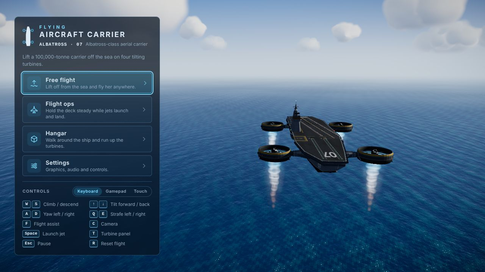
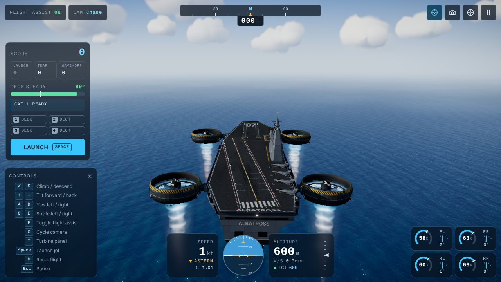
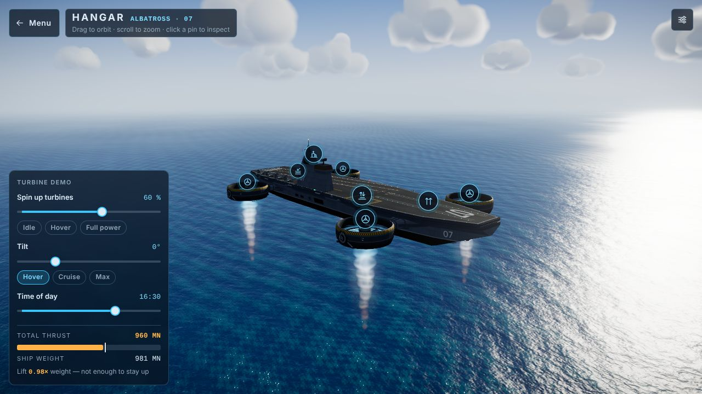

# Flying Aircraft Carrier

An interactive 3D web app: view, fly and operate **ALBATROSS 07**, an original flying
aircraft carrier lifted by four tilting ducted-fan jet turbines. It runs in the browser with
no install, on desktop and on phones.



Everything on screen and everything you hear is generated in code. There are no model,
texture or audio files, and the app makes no network requests after it has loaded.

## What you can do

| Mode | What it is |
|---|---|
| **Free flight** | Start afloat with idle engines, lift off, and fly anywhere. |
| **Flight ops** | Hold the deck steady in a gusty wind while four jets launch from the catapults, fly a circuit and land on the wires. Each recovery scores higher the steadier and more level the deck is; an unsteady deck holds launches and waves landings off. |
| **Hangar** | Orbit the ship, click the pins on the turbines, island, catapults, arrestor wires and elevator for an info card, and run the turbines up and tilt them with the demo sliders. |
| **Settings** | Graphics preset (Low / Medium / High, with automatic downgrade when the frame rate drops), time of day, volumes, invert Y, camera shake, touch controls, key rebinding. |



Two ways to fly:

- **Flight assist on (default).** A flight computer holds altitude and keeps the deck level.
  You set a target altitude, a forward tilt for all four nacelles, a turn rate and a sideways
  slide.
- **Flight assist off.** You command each turbine's throttle and tilt yourself, with the keys
  or per turbine in the turbine panel. Nothing stabilises the ship.

Each turbine can also be switched off in flight to see how the ship copes.



## Controls

| Action | Keyboard | Gamepad | Touch |
|---|---|---|---|
| Climb / descend | W / S | RT / LT | Right slider |
| Tilt turbines forward / back | ↑ / ↓ | Right stick ↕ | Left stick ↕ |
| Yaw left / right | A / D | Left stick ↔ | Left stick ↔ |
| Strafe left / right | Q / E | LB / RB | ◀ ▶ buttons |
| Toggle flight assist | F | Y | Button |
| Cycle camera (chase, orbit, deck, bridge, turbine) | C | Select | Button |
| Launch jet (flight ops) | Space | A | Button |
| Turbine panel | T | X | Button |
| Pause | Esc | Start | HUD button |
| Reset flight | R | – | Pause menu |
| Look around / zoom | Drag / wheel | – | Drag / pinch |

Keyboard keys can be rebound in Settings.

## Getting started

Requires Node.js 22 or newer.

```bash
npm install
```

```bash
npm run dev
```

Then open the address Vite prints (by default http://127.0.0.1:5173/).

## Scripts

| Command | What it does |
|---|---|
| `npm run dev` | Development server with hot reload |
| `npm run build` | Typecheck, then build the static site into `dist/` |
| `npm run preview` | Serve the built site locally |
| `npm run typecheck` | TypeScript project check |
| `npm run lint` | ESLint |
| `npm run format` / `npm run format:check` | Prettier |
| `npm test` | Unit tests (Vitest) |
| `npm run e2e` | End-to-end tests (Playwright; builds and serves the site first) |
| `npm run shot -- --url <url> --out <file.png>` | Headless screenshot helper (`scripts/shot.mjs`) |

## Tech stack

Vite, TypeScript, React 18, three.js through React Three Fiber and drei, Rapier
(`@react-three/rapier`, loaded lazily when a flight starts), `postprocessing` for bloom, tone
mapping, vignette and heat shimmer, Zustand for UI state, the Web Audio API for sound, Vitest
and Playwright for tests. Versions are pinned in `package.json`.

## How it is put together

`docs/ARCHITECTURE.md` is the full contract. In short:

- **`sim`** (`src/state/sim.ts`) is one mutable object holding the live simulation: ship pose
  and velocities, the four turbines, pilot controls, environment, jets and camera. The 3D
  scene reads it every frame without going through React.
- **Drivers** write `sim`. The idle driver hovers the ship in the menu and hangar. The physics
  driver runs a Rapier rigid body: each turbine pushes at its own mount point, so pitch, roll
  and yaw come out of the thrust geometry, with drag, wind and buoyancy from the wave field.
  The force model and flight computer are pure functions and are unit-tested without a browser.
- **The store** (`src/state/useGameStore.ts`) holds what the UI needs: screen, settings
  (saved in `localStorage`), a 10 Hz telemetry snapshot, flight-ops score, toasts.
- **Input** from keyboard, gamepad and touch is merged into one set of pilot axes and an
  action bus.

```
src/
├── App.tsx, main.tsx
├── config/      ship layout, physics constants, quality presets, wave table, palette
├── state/       sim, store, telemetry, actions, events, key bindings
├── sim/         idle driver (menu, hangar)
├── physics/     Rapier driver, flight computer, actuators, wind
├── carrier/     hull, deck, island, turbines, exhaust, force model
├── aircraft/    jets, catapult launch, pattern, recovery and scoring
├── scene/       sky and lighting, clouds, ocean, camera rig, post-processing
├── controls/    keyboard, gamepad and touch layers
├── ui/          menu, hangar, HUD, turbine panel, ops HUD, settings, pause
├── audio/       synthesised turbine, wind, sea and one-shot sounds
└── dev/         component sandboxes (development only)
tests/
├── unit/        Vitest
└── e2e/         Playwright smoke and screenshot tests
```

## Testing

- **Unit:** thrust vectors and sign conventions, drag and buoyancy, the flight computer
  (take-off, hover, cruise, turns, engine failures, manual hand-over), waves, camera maths,
  hull geometry, flight-ops logic and scoring, input mapping, HUD maths, audio mappings.
- **End-to-end:** the app loads and draws; holding W lifts the ship off the sea; yaw and
  camera keys; a turbine-panel slider drives its turbine in manual mode; pause; hangar
  hotspots and demo sliders; settings persist across a reload; a jet launches in flight ops.
- **Screenshot comparison** of the hangar is opt-in, because rendering differs between
  machines. Create baselines on your machine first:

```bash
VISUAL=1 npx playwright test visual --update-snapshots
```

Outside this repository's CI, install the test browser once with
`npx playwright install chromium`.

## URL flags

For testing and screenshots; all optional and combinable.

| Flag | Effect |
|---|---|
| `?screen=menu\|hangar\|flight\|ops` | Start on a screen |
| `?quality=low\|medium\|high` | Force a graphics preset and switch automatic downgrade off |
| `?time=<hours>` | Time of day, 0–24 |
| `?cam=orbit\|chase\|deck\|bridge\|turbine` | Initial camera |
| `?assist=0` | Start with flight assist off |
| `?fixedTime=<seconds>` | Freeze the menu or hangar scene at that time, for identical frames |
| `?ui=0` | Hide the interface |
| `?mute=1` | Start muted |
| `?touch=1` | Show the touch controls |
| `?sandbox=<name>` | Development only: show one module in isolation (`src/dev/sandboxes/`) |

`window.__FAC__` exposes the store, `sim`, the input sources and the action bus for tests and
the console.

## Deployment

The build is a static site with relative asset paths, so `dist/` can be served from any
directory of any static host.

`.github/workflows/ci.yml` lints, typechecks, tests and builds on pull requests and on pushes
to `main`, runs the end-to-end tests, and deploys `dist/` to GitHub Pages from `main`. To use
it, set **Settings → Pages → Source** to **GitHub Actions**.

## Status and known limitations

The plan this was built from is in `PLAN.md`. Differences from it and open points:

- **Art is procedural.** The ship, turbines and jets are built from code-generated geometry
  and painted textures, not Blender models (the plan's final-art milestone). They sit behind
  the same components, so models could replace them later.
- **Sound is synthesised** with the Web Audio API instead of Howler and audio files. Levels
  and spectra were checked by measurement only; nobody has listened to the mix yet.
- **Touch layout** differs from the plan's table: the left stick does yaw and tilt, the right
  slider does climb and descend, and strafe is on two buttons, so each thumb has one job.
- **No live tuning panel.** The plan's Leva panel was not built; constants are in
  `src/config/physicsConfig.ts`.
- **Tested in headless Chromium only**, with software rendering. Frame rate on real graphics
  hardware, real phones, real gamepads and other browsers has not been measured.
- **Not done from the plan's release milestone:** Lighthouse pass, the v1.0 tag, and a first
  run of the CI and Pages workflow on GitHub.
- **Visual rough edges:** a faint regular pattern on the sea at mid distance from high up;
  clouds look soft close up; hangar pins are not hidden when their part is behind the ship.
- **Flight feel:** there is no position hold, so the ship drifts with the wind in a hover; with
  one engine out it descends under partial control, and with two adjacent engines out it falls.

## Design

The ship, aircraft, names and markings are original. They are not based on any vehicle,
name or insignia from a film, comic, game or real navy.
